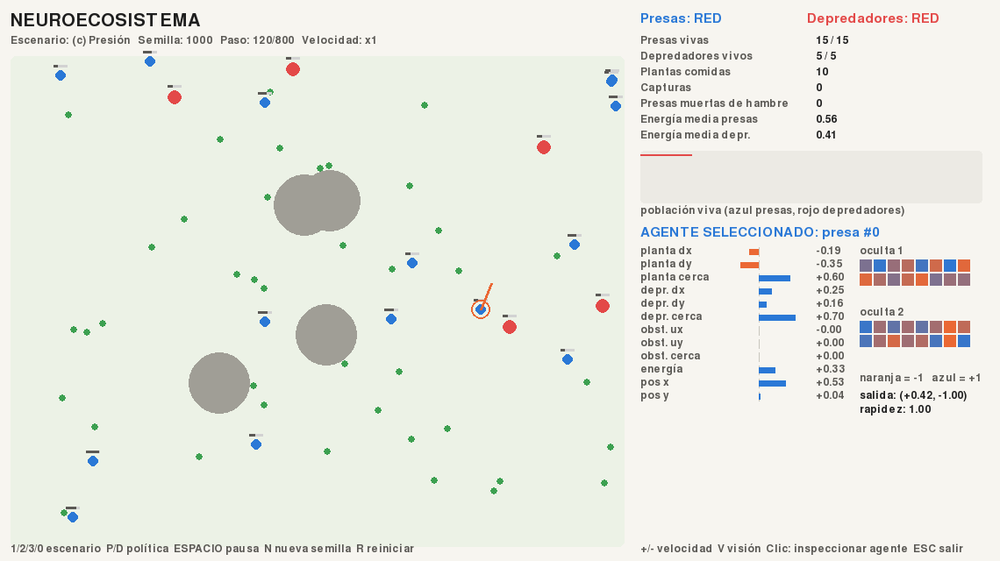

# NeuroEcosistema – Depredadores y presas

Proyecto final integrador · Electiva I de Profundización – Inteligencia Artificial · Universidad Santo Tomás, seccional Tunja.

Simulación 2D en la que **presas** y **depredadores** se mueven según la salida de **redes neuronales multicapa** (dos capas ocultas, escritas a mano con NumPy). Las redes se entrenan por **neuroevolución** (algoritmo genético sobre los pesos) y se comparan, con semillas registradas, contra redes sin entrenar, contra una arquitectura más pequeña y contra agentes de referencia **aleatorios** y **basados en reglas**.


*Escenario (c). La presa seleccionada (círculo naranja) ve un depredador abajo a la derecha y su red decide huir hacia arriba a máxima rapidez (flecha naranja). A la derecha se ven sus 12 entradas y las 32 neuronas de sus dos capas ocultas.*

**Pregunta orientadora:** ¿en qué condiciones los agentes controlados por redes neuronales desarrollan comportamientos de búsqueda, persecución y evasión que mejoran su desempeño frente a estrategias sin aprendizaje?

| Documento | Contenido |
|---|---|
| [`docs/INFORME.md`](docs/INFORME.md) | Informe técnico: problema, arquitectura, metodología, resultados, discusión, fallos y recomendaciones |
| [`docs/BITACORA.md`](docs/BITACORA.md) | Bitácora de decisiones técnicas (alternativas, evidencia y criterio) |
| [`docs/GUIA_SUSTENTACION.md`](docs/GUIA_SUSTENTACION.md) | Explicación de todo el código y preguntas probables de la sustentación |
| [`resultados/resumen.md`](resultados/resumen.md) | Tablas de resultados generadas automáticamente |

## Instalación

Requiere Python 3.12 o superior.

```bash
uv sync                       # con uv (recomendado)
# o bien
pip install -r requirements.txt
```

## Ejecución

```bash
uv run simulacion.py          # simulación en vivo con los modelos ya entrenados
uv run experimentos.py        # repite TODOS los experimentos (tablas y gráficas), ~1 min
uv run entrenar.py --todo     # vuelve a entrenar los 6 modelos desde cero, ~15 min cada uno
```

Entrenar un solo modelo:

```bash
uv run entrenar.py --especie presa
uv run entrenar.py --especie depredador --ocultas 4 4 --nombre depredador_4x4
uv run entrenar.py --especie presa --generaciones 100 --semilla 7 --nombre presa_prueba
```

### Controles de la simulación

| Tecla | Acción |
|---|---|
| `1` `2` `3` `0` | Escenario (a) abundancia, (b) escasez, (c) presión, entrenamiento |
| `P` / `D` | Cambia la política de presas / depredadores: red 16×16 → red 4×4 → reglas → aleatoria → sin entrenar. La "red 16×16" de la presa es el modelo con mutación σ = 0.04 (el mejor, ver E5) |
| `Espacio` | Pausa |
| `N` / `R` | Nuevo episodio con la siguiente semilla / reiniciar la misma semilla |
| `+` / `-` | Velocidad |
| `V` | Muestra el radio de visión |
| Clic | Selecciona un agente: se ven sus 11–12 entradas, las activaciones de sus dos capas ocultas y su salida (flecha naranja) |

## Estructura

| Archivo | Qué hace |
|---|---|
| `config.py` | **Todos** los parámetros: mundo, escenarios, redes, entrenamiento y semillas |
| `mundo.py` | Simulación vectorizada (muchos mundos a la vez): percepción, movimiento, energía, comer, captura, rebrote, fin de episodio y métricas |
| `red.py` | Red neuronal multicapa (entradas → 16 → 16 → 2, tanh) y guardado/carga de modelos |
| `politicas.py` | Políticas: red neuronal, reglas (referencia) y aleatoria (referencia) |
| `evolucion.py` | Neuroevolución: evaluación, elitismo, torneo, cruce y mutación |
| `entrenar.py` | Entrena y guarda modelos, historial por generación y configuración |
| `experimentos.py` | Experimentos E1–E5 y análisis de comportamiento en los 3 escenarios con 10 semillas, pruebas estadísticas y gráficas |
| `simulacion.py` | Visualización con Pygame e inspección de la red de cada agente |
| `modelos/` | Modelos entrenados (`.npz`), incluyen el genoma inicial para comparar antes/después |
| `resultados/` | Historial de entrenamiento (`.csv`), configuraciones (`.json`), datos crudos, resumen y figuras |

## Reproducibilidad

* Semilla de entrenamiento: `42` (`config.EVOLUCION["semilla"]`). Cada generación usa semillas de mapa que quedan escritas en `resultados/entrenamiento_*.csv`.
* Semillas de validación (para elegir el campeón): `500–507`.
* Semillas de prueba (solo para experimentos, nunca para entrenar): `1000–1009`.
* Cada entrenamiento guarda su configuración completa en `resultados/config_<modelo>.json`.
* Cada mundo se genera solo con su propia semilla, así que el mapa de la semilla 1000 es idéntico en todas las condiciones.
