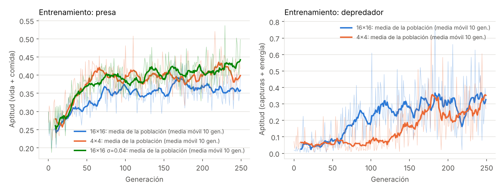
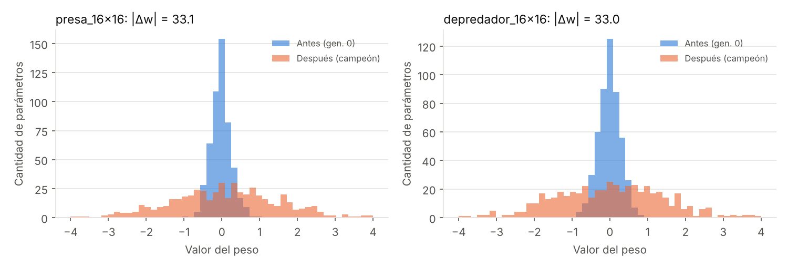
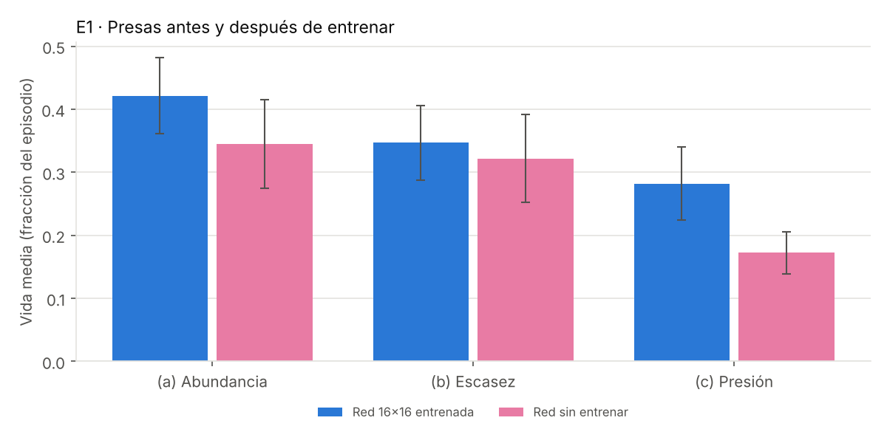
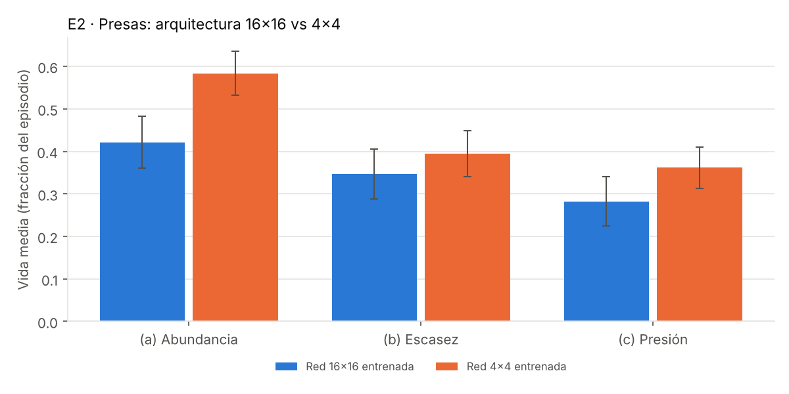
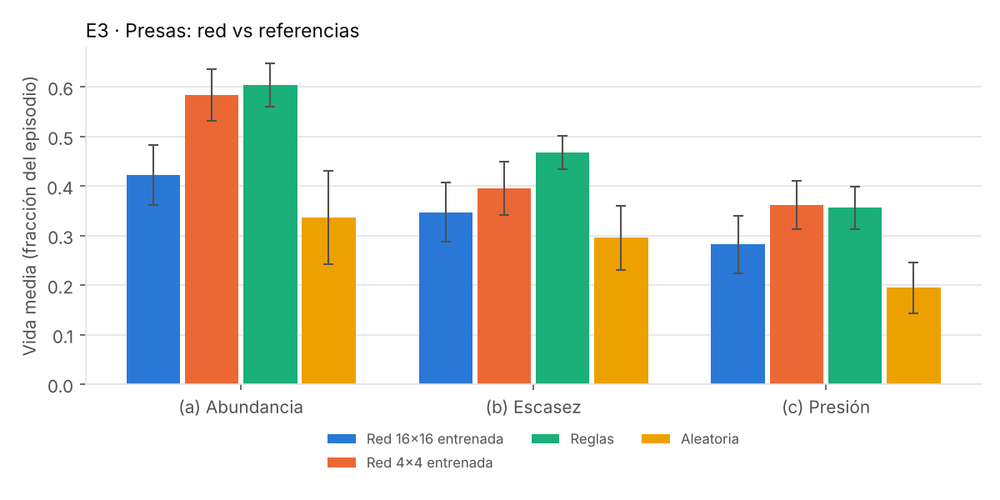
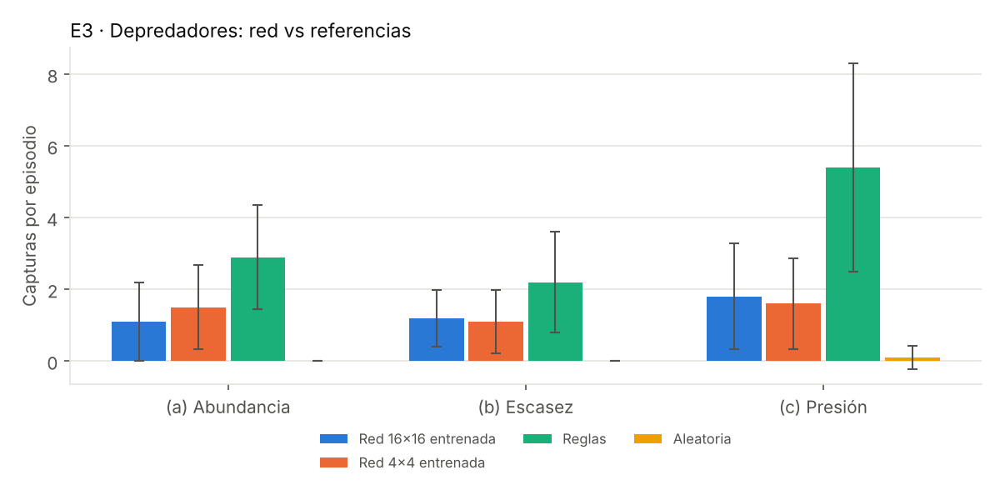
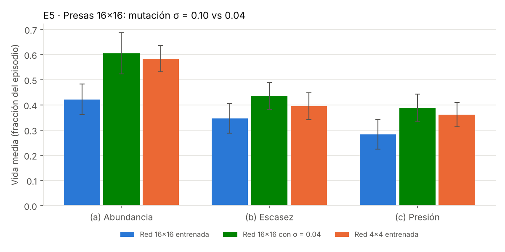

# Informe técnico – NeuroEcosistema: depredadores y presas

Universidad Santo Tomás, seccional Tunja · Facultad de Ingeniería de Sistemas · Electiva I de Profundización – Inteligencia Artificial · Docente: Diego Alejandro Vela Beltrán

---

## 1. Problema

**Pregunta orientadora:** ¿en qué condiciones los agentes controlados por redes neuronales desarrollan comportamientos de búsqueda, persecución y evasión que mejoran su desempeño frente a estrategias sin aprendizaje?

Construimos un ecosistema 2D (700 × 560 px) con plantas, 15 presas y 2–5 depredadores. Las presas deben comer para no morir de hambre y evitar ser capturadas. Los depredadores deben capturar presas para recuperar energía. Cada agente decide en cada paso hacia dónde y a qué rapidez moverse, con la salida de una red neuronal. Las redes se entrenan por neuroevolución y se comparan, con semillas registradas, contra redes sin entrenar, contra otra arquitectura y contra agentes aleatorios y basados en reglas.

**Respuesta corta (sección 7):** las redes desarrollan **evasión** en todas las configuraciones entrenadas. Desarrollan **búsqueda** solo cuando la búsqueda genética está bien ajustada (red pequeña, o red grande con mutación pequeña), y desarrollan solo una **persecución** débil. Superan siempre a las estrategias sin aprendizaje (aleatoria y red sin entrenar). Frente a las reglas programadas, la mejor presa queda estadísticamente empatada en los tres escenarios (en escasez sigue por debajo en promedio: 0.436 contra 0.468, p = 0.13), y los depredadores pierden en todos.

## 2. Entorno

| Elemento | Regla |
|---|---|
| Movimiento | `posición += acción × velocidad_máx`; la acción es un vector de longitud ≤ 1. Presa: 2.0 px/paso; depredador: 2.3 px/paso. Paredes y obstáculos circulares (r = 35) bloquean. |
| Energía | Por paso: `costo_base + costo_mov × rapidez²`. Presa: 0.0016 + 0.0015·r²; depredador: 0.0008 + 0.0025·r². Inicial: 0.7 y 0.8; máximo 1.0. |
| Comer | Presa a < 9 px de una planta activa: +0.30. La planta rebrota en otro lugar con probabilidad `rebrote` por paso. |
| Captura | Depredador a < 11 px de una presa: la presa muere y el depredador gana +0.45. |
| Muerte | Energía 0 (hambre) o captura. |
| Fin del episodio | 800 pasos o ninguna presa viva. |
| Percepción | Presa: 130 px; depredador: 170 px. |

La simulación (`mundo.py`) está **vectorizada**: simula B mundos a la vez con arreglos NumPy. Así cada generación evalúa 64 mundos en ~3.5 s.

**Escenarios** (solo cambia esto; todo lo demás es constante):

| Escenario | Depredadores | Plantas | Rebrote | Obstáculos |
|---|---|---|---|---|
| Entrenamiento | 3 | 35 | 0.015 | 2 |
| (a) Abundancia | 2 | 45 | 0.020 | 0 |
| (b) Escasez | 2 | 12 | 0.004 | 0 |
| (c) Presión | 5 | 45 | 0.020 | 4 |

## 3. Arquitectura de los agentes

**Entradas** (relativas, normalizadas; 0 si no hay nada dentro del radio de visión):

| Presa (12) | Depredador (11) |
|---|---|
| planta más cercana: dx, dy, cercanía | presa más cercana: dx, dy, cercanía |
| depredador más cercano: dx, dy, cercanía | velocidad de esa presa: vx, vy |
| obstáculo más cercano: ux, uy, cercanía | obstáculo más cercano: ux, uy, cercanía |
| energía propia | energía propia |
| posición x, y en [−1, 1] | posición x, y en [−1, 1] |

**Red:** entradas → 16 (tanh) → 16 (tanh) → 2 (tanh). Presa: 514 parámetros; depredador: 498. Alternativa: 4 → 4 (82 y 78). Las dos salidas forman el vector de movimiento. Como el costo crece con el cuadrado de la rapidez, la red puede **administrar su energía** eligiendo moverse despacio o rápido.

Los modelos de cada especie están diferenciados: tienen entradas distintas (solo el depredador percibe la velocidad del rival y solo la presa percibe plantas) y criterios de aptitud distintos.

**Agentes de referencia** (`politicas.py`), con exactamente las mismas observaciones que la red:
* **Reglas – presa:** si ve un depredador, huye en dirección contraria; si no, va a la planta más cercana; si no, deambula. Evita paredes y obstáculos.
* **Reglas – depredador:** persigue la posición futura estimada de la presa (posición + velocidad × 8 pasos); si no ve presas, deambula.
* **Aleatoria:** caminata con rumbo persistente a 0.6 de la velocidad máxima.

## 4. Entrenamiento

**Neuroevolución** (`evolucion.py`). Una población de 32 genomas (vectores con todos los pesos). En cada generación:
1. Cada genoma controla a todos los agentes de su especie en 2 mapas, los mismos para todos los genomas de esa generación. El rival es siempre la política de reglas de la otra especie.
2. **Aptitud.** Presa: `vida media + 0.02 × plantas por presa`. Depredador: `capturas por depredador + 0.3 × energía final media`.
3. Elitismo (4 mejores intactos), torneo de 3, cruce uniforme (probabilidad 0.5) y mutación `w ← w + N(0, σ)` con σ = 0.10.
4. 250 generaciones. El campeón se elige entre los 5 mejores re-evaluándolos en 8 mapas de validación (semillas 500–507).

**Evidencia de entrenamiento real.** La aptitud media de la población sube de forma sostenida (figura 1). El campeón está a una distancia |Δw| ≈ 33 del mejor genoma inicial, y la distribución de sus pesos es muy distinta (figura 2). Cada modelo guarda su genoma inicial en el `.npz`, junto a la configuración completa (`resultados/config_*.json`) y la aptitud por generación con las semillas usadas (`resultados/entrenamiento_*.csv`).

*Figura 1. Aptitud media de la población por generación (línea gruesa: media móvil de 10 generaciones). La de la presa 16×16 con σ = 0.10 (azul) se estanca por debajo de las demás.*

*Figura 2. Distribución de los pesos del mejor genoma de la generación 0 y del campeón.*

## 5. Metodología experimental

* **Repeticiones:** 10 por condición y escenario, con las semillas de prueba 1000–1009, que nunca se usaron para entrenar ni validar.
* **Diseño pareado:** cada mundo se genera solo con su semilla, así que las 10 posiciones iniciales son idénticas en todas las condiciones.
* **Variable controlada:** al evaluar presas, los depredadores son siempre los de reglas; al evaluar depredadores, las presas son siempre las de reglas.
* **Métricas:** vida media de las presas (fracción de los 800 pasos), supervivencia final, alimento consumido, capturas, energía final, paso de la primera captura, paso medio de captura, muertes por hambre y su desviación estándar entre repeticiones.
* **Prueba estadística:** permutación pareada de cambio de signo (20 000 permutaciones) sobre la diferencia media; se informa el valor p bilateral.
* **Reproducción:** `uv run experimentos.py` regenera `resultados/datos_experimentos.csv` (datos crudos), `resultados/resumen.md` (tablas completas) y las figuras. Dos ejecuciones dan resultados idénticos.

## 6. Resultados

Las tablas completas, con todas las métricas, están en `resultados/resumen.md`. Aquí se presentan las comparaciones exigidas.

### E1. Antes y después del entrenamiento

**Hipótesis.** La red entrenada supera a la misma arquitectura con pesos aleatorios. **Variable:** pesos (iniciales o entrenados). **Constantes:** arquitectura 16×16, rival, mapas.

| Escenario | Presa: vida media, sin entrenar → entrenada (p) | Depredador: capturas, sin entrenar → entrenado (p) |
|---|---|---|
| (a) | 0.345 → 0.422 (p = 0.006) | 0.0 → 1.1 (p = 0.033) |
| (b) | 0.322 → 0.347 (p = 0.26) | 0.0 → 1.2 (p = 0.008) |
| (c) | 0.172 → 0.282 (p = 0.004) | 0.1 → 1.8 (p = 0.008) |

**Análisis.** El entrenamiento mejora a las dos especies, con significancia en 5 de 6 casos. La excepción es la presa en escasez (b): la diferencia (+0.025) no es significativa. Las redes sin entrenar casi no se mueven (rapidez ≈ 0.35) y no huyen (coseno de evasión +0.10), por eso en (c) sufren 13.9 capturas de 15 posibles. **Conclusión:** se acepta la hipótesis, salvo para la presa en (b).

### E2. Comparación de arquitecturas: 16×16 contra 4×4

**Hipótesis (previa).** La red 16×16, con más capacidad, rinde más. **Variable:** tamaño de las capas ocultas. **Constantes:** entradas, salidas, algoritmo, σ = 0.10, 250 generaciones y semilla 42.

| Escenario | Presa 16×16 | Presa 4×4 | p | Depr. 16×16 (capturas) | Depr. 4×4 | p |
|---|---|---|---|---|---|---|
| (a) | 0.422 ± 0.061 | **0.584 ± 0.052** | 0.002 | 1.1 ± 1.1 | 1.5 ± 1.2 | 0.50 |
| (b) | 0.347 ± 0.059 | 0.395 ± 0.054 | 0.12 | 1.2 ± 0.8 | 1.1 ± 0.9 | 1.00 |
| (c) | 0.282 ± 0.058 | **0.361 ± 0.049** | 0.014 | 1.8 ± 1.5 | 1.6 ± 1.3 | 0.84 |

**Análisis.** El resultado **contradice la hipótesis**: la red pequeña es mejor para la presa (significativo en (a) y (c)), y en los depredadores no hay diferencia. La tabla de comportamiento (sección 6.1) muestra la causa: la presa 16×16 **no aprendió a buscar comida** (coseno hacia la planta −0.15) y come 8.8 plantas en (a), contra 27.0 de la 4×4. Lo atribuimos a la mutación: σ = 0.10 aplicado a 514 pesos desplaza la red ≈ 2.3 unidades por mutación, contra ≈ 0.9 en la 4×4, y eso dificulta el ajuste fino. Esta explicación se comprobó en E5. **Conclusión:** con σ fijo, más neuronas no rinden más, porque el cuello de botella es la búsqueda genética y no la capacidad.

### E3. Red contra agentes de referencia

**Hipótesis.** La red entrenada supera al agente aleatorio y se acerca al agente de reglas. **Variable:** política de la especie evaluada. **Constantes:** rival, mapas.

| Escenario | Presa aleatoria | Presa reglas | Red 16×16 | Red 4×4 | 4×4 − reglas (p) |
|---|---|---|---|---|---|
| (a) | 0.337 | 0.603 | 0.422 | 0.584 | −0.020 (0.18) |
| (b) | 0.296 | 0.468 | 0.347 | 0.395 | −0.073 (0.006) |
| (c) | 0.194 | 0.356 | 0.282 | 0.361 | +0.006 (0.81) |

| Escenario | Depr. aleatorio | Depr. reglas | Red 16×16 | Red 4×4 | 16×16 − reglas (p) |
|---|---|---|---|---|---|
| (a) | 0.0 | 2.9 | 1.1 | 1.5 | −1.8 (0.015) |
| (b) | 0.0 | 2.2 | 1.2 | 1.1 | −1.0 (0.07) |
| (c) | 0.1 | 5.4 | 1.8 | 1.6 | −3.6 (0.006) |

**Análisis.** Las redes 16×16 y 4×4 de ambas especies superan al agente aleatorio en los tres escenarios (todas las pruebas con p ≤ 0.035; ver `resumen.md`). La presa 4×4 **empata estadísticamente con las reglas** en (a) y (c) y pierde en (b). Los depredadores neuronales capturan entre el 30 % y el 55 % de lo que capturan los de reglas. **Conclusión:** la red supera a las estrategias sin aprendizaje, pero no a una estrategia diseñada con conocimiento del problema.

### E4. ¿Importa ver al depredador? (representación del entorno)

| Escenario | Presa 16×16 | Presa 16×16 sin sensor de depredador | p | Capturas (con / sin) | Comida (con / sin) |
|---|---|---|---|---|---|
| (a) | 0.422 | 0.396 | 0.42 | 4.7 / 9.0 | 8.8 / 22.9 |
| (b) | 0.347 | 0.303 | 0.06 | 5.3 / 6.7 | 2.5 / 8.2 |
| (c) | 0.282 | 0.223 | 0.037 | 9.3 / 12.4 | 7.4 / 11.5 |

**Análisis.** Sin el sensor, la presa sufre más capturas en todos los escenarios, pero come más: al no "asustarse", dedica más tiempo a buscar. El sensor solo se traduce en mayor vida media cuando hay muchos depredadores (c). **Conclusión:** la información del depredador es útil y la red la usa para evadir, pero en abundancia no compensa lo que se pierde en alimento.

### E5. Mejora comprobada: mutación ajustada al tamaño de la red

**Hipótesis.** Si el problema de la 16×16 es el tamaño de la mutación, con σ = 0.04 (desplazamiento ≈ 0.9, igual que la 4×4) debería alcanzar a la 4×4.

| Escenario | 16×16, σ = 0.10 | 16×16, σ = 0.04 | p | 4×4, σ = 0.10 | Reglas | σ 0.04 − reglas (p) |
|---|---|---|---|---|---|---|
| (a) | 0.422 | **0.605** | 0.002 | 0.584 | 0.603 | +0.001 (0.97) |
| (b) | 0.347 | **0.436** | 0.004 | 0.395 | 0.468 | −0.032 (0.13) |
| (c) | 0.282 | **0.388** | 0.002 | 0.361 | 0.356 | +0.032 (0.10) |

**Análisis.** La hipótesis se confirma: con σ = 0.04 la 16×16 mejora con significancia en los 3 escenarios. Iguala a la 4×4 (p = 0.44 en (a)), aprende a buscar comida (coseno +0.39) y queda **estadísticamente empatada con las reglas en los tres escenarios**. Es nuestra mejor presa.

### 6.1 Comportamientos aprendidos

Coseno entre la acción y la dirección del objetivo visible (+1 = hacia él; −1 = en contra), promediado sobre todos los pasos de los 3 escenarios:

| Presa | Rapidez sin amenaza | Rapidez viendo depredador | Búsqueda | Evasión |
|---|---|---|---|---|
| Red 16×16 (σ 0.10) | 0.40 | 0.96 | −0.15 | +0.40 |
| Red 4×4 | 0.37 | 0.85 | +0.42 | +0.42 |
| Red 16×16 (σ 0.04) | 0.32 | 0.96 | +0.39 | +0.45 |
| Sin entrenar | 0.33 | 0.38 | −0.27 | +0.10 |
| Reglas | 0.73 | 1.00 | +0.51 | +0.71 |
| Aleatoria | 0.60 | 0.60 | −0.01 | +0.05 |

| Depredador | Rapidez | Persecución |
|---|---|---|
| Red 16×16 | 0.98 | +0.30 |
| Red 4×4 | 0.93 | +0.27 |
| Sin entrenar | 0.35 | −0.10 |
| Reglas | 0.79 | +0.82 |

Las presas entrenadas desarrollaron una estrategia propia, distinta de las reglas: **caminar despacio para ahorrar energía** (0.32–0.40 contra 0.73) y **acelerar al ver un depredador**. Con eso compensan una evasión menos precisa (+0.45 contra +0.71). Los depredadores aprendieron una persecución débil (+0.30) y corren casi siempre al máximo.

## 7. Discusión

**Respuesta a la pregunta orientadora.** Los comportamientos aparecieron en este orden de facilidad:
1. **Evasión:** aparece en todas las redes entrenadas. Es la señal más fuerte en la aptitud (una captura acaba con la vida de la presa).
2. **Búsqueda:** aparece solo cuando (i) el entorno la hace necesaria (intento 1: con metabolismo bajo no se aprendió) y (ii) la mutación es proporcional al tamaño de la red (E2 y E5).
3. **Persecución:** queda débil. La recompensa es escasa (pocas capturas por episodio) y el entorno castiga al depredador por moverse.

La mejora frente a las estrategias **sin aprendizaje** (aleatoria y red sin entrenar) es consistente y significativa. Frente a las **reglas**, la mejor presa empata en los tres escenarios, y los depredadores pierden siempre.

**Resultados que contradijeron nuestras expectativas:**
* La red más grande fue peor (E2). La causa no era la capacidad sino la mutación (E5).
* Más información (sensor de depredador) no siempre da más vida (E4, escenario a).
* Más generaciones no mejoraron a la presa 16×16 con σ = 0.10: vida 0.475 con 100 generaciones (intento 2) contra 0.422 con 250. Con σ grande, el entrenamiento oscila en lugar de afinar.
* En el ecosistema completo (redes contra redes), en (c) las presas viven más que con reglas contra reglas (0.414 contra 0.356), simplemente porque los depredadores neuronales son malos cazadores. Un indicador agregado puede ocultar que una especie "gana" por debilidad de la otra.

## 8. Fallos y limitaciones

* **Intento 1:** el criterio de aptitud se podía maximizar sin comer (premiaba ahorrar energía). Se corrigió con el metabolismo (bitácora D4).
* **Intento 2:** 100 generaciones no bastaban. La aptitud seguía subiendo y los campeones dependían de la suerte de sus mapas (D5).
* **Depredadores:** mueren de hambre en casi todas las condiciones, incluso con reglas (1.9 de 2 en (a)). El entorno está desequilibrado en su contra. Ni el término de energía ni el moldeado de recompensa lo corrigieron.
* **Una sola semilla de entrenamiento por modelo.** Las conclusiones sobre arquitecturas se basan en una corrida de entrenamiento por configuración, aunque se evalúan con 10 mapas de prueba. Otra semilla de entrenamiento podría cambiar el orden de 16×16 y 4×4 con σ = 0.10.
* **Las pruebas exploratorias** (`resultados/exploraciones.md`) se hicieron con 40 generaciones y una corrida: son evidencia débil.
* **Rival fijo:** las redes nunca entrenaron contra la otra red, así que el ecosistema completo es una extrapolación.
* **Varias comparaciones:** se hicieron muchas pruebas sin corregir por comparaciones múltiples. Los valores p cercanos a 0.05 deben leerse con cautela.

## 9. Recomendaciones

1. **Rebalancear la energía del depredador** (más energía por captura o menos costo de movimiento) hasta que el agente de reglas sobreviva a la mitad de los episodios, y volver a entrenar. Es la primera prioridad: hoy el entorno, y no la red, limita a los depredadores.
2. Usar **σ ∝ 1/√(número de parámetros)**, comprobado en E5, o una mutación adaptativa.
3. **Entrenar en varios escenarios a la vez**, para mejorar la generalización a la escasez, donde ninguna red supera a las reglas.
4. Entrenar **3–5 semillas por configuración** y reportar la variabilidad entre entrenamientos, no solo entre mapas de prueba.
5. Probar la **coevolución** una vez estabilizado el depredador, partiendo de los campeones actuales.
6. Percibir **2 objetos por tipo** para mejorar la evasión con varios depredadores (escenario c).

## 10. Declaración de uso de herramientas de IA generativa

Se usó **Claude (Anthropic)** como asistente de programación y redacción para: proponer la arquitectura del código, escribir la simulación, la red, el algoritmo genético, los experimentos y la visualización, y redactar borradores de este informe, la bitácora y la guía de estudio.

* **Recomendaciones aceptadas:** simulación vectorizada, neuroevolución en lugar de supervisado, rival fijo, diseño pareado con prueba de permutación, el análisis de comportamiento por cosenos y el experimento E5 sobre σ.
* **Recomendaciones rechazadas o descartadas con evidencia:** subir el peso de la comida y el moldeado de recompensa del depredador (no mejoraron); el metabolismo inicial (intento 1) y 60/100 generaciones (intento 2).
* **Validaciones realizadas:** ejecución de todo el código; verificación del número de parámetros (514, 498, 82 y 78); comprobación de que dos ejecuciones de los experimentos dan resultados idénticos; revisión visual de la simulación y de las gráficas; y contraste de cada cifra del informe con `resultados/resumen.md`.

**El equipo debe completar este apartado** con lo que haya verificado, modificado o rechazado por su cuenta.

## Anexos

* `resultados/resumen.md`: tablas completas con todas las métricas y pruebas.
* `resultados/datos_experimentos.csv`: datos crudos (una fila por condición, escenario y semilla).
* `resultados/entrenamiento_*.csv` y `resultados/config_*.json`: historial y configuración de cada entrenamiento.
* `resultados/intento1/`, `resultados/intento2/` y `resultados/exploraciones.md`: intentos descartados.
* `docs/BITACORA.md`: bitácora de decisiones.
